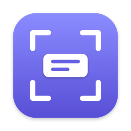
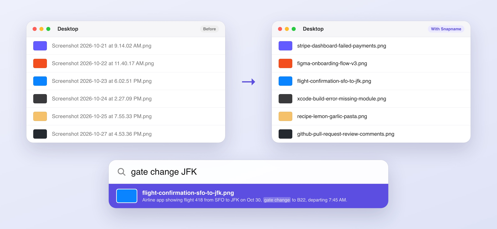

<p align="center"></p>

# Snapname

**Screenshots that name themselves — and that you can search by what's in them. Free, private and fully on your Mac.**

Your Desktop is full of `Screenshot 2026-10-27 at 4.53.36 PM.png`. You took every one because it mattered, and now you can't find any of them.

Snapname lives in your menu bar. Every time you take a screenshot, a local AI (via [Ollama](https://ollama.com)) looks at it, gives it a real name, and writes a one-line description that Spotlight can search. No accounts, no subscriptions, no cloud. Your screenshots never leave your Mac.

> `Screenshot 2026-10-23 at 6.02.51 PM.png` → **flight-confirmation-sfo-to-jfk.png**
> `Screenshot 2026-10-24 at 2.27.09 PM.png` → **xcode-build-error-missing-module.png**
> `Screenshot 2026-10-21 at 9.14.02 AM.png` → **stripe-dashboard-failed-payments.png**

<p align="center"></p>

## Install (no technical knowledge needed)

1. Open **Terminal** (press ⌘-Space, type `Terminal`, press Return).
2. Paste this line and press Return:
   ```sh
   curl -fsSL https://raw.githubusercontent.com/nileshkr9919/snapname/main/install.sh | zsh
   ```
3. Wait for **All set!** The first install downloads about 10 GB of AI model, so it can take a while. Already using [Voice Notes](https://github.com/nileshkr9919/voice-notes)? They share the same model, so there's nothing extra to download.
4. Click **Allow** when macOS asks for access to your Desktop.

You don't need anything installed beforehand. The installer sets up Ollama, downloads the model, and installs a ready-made Snapname app into your Applications folder. To update, run the same line again.

**Requirements:** macOS 14 Sonoma or later, about 12 GB free disk space, and 16 GB of memory recommended (8 GB works with a smaller model: `MODEL=gemma3:4b` before `zsh` in the command above).

## Using it
There's nothing to learn and nothing to open. Take screenshots exactly like you do now (⌘⇧3, ⌘⇧4, ⌘⇧5) and a few seconds later they have a real name.

- 🏷 **Real names** — `figma-onboarding-flow-v3.png` instead of a timestamp, in a couple of seconds.
- 🔎 **Search by what's inside** — Snapname saves a description with the names, numbers and text it sees, so ⌘-Space "gate change JFK" finds the airline screenshot even though those words aren't in its name.
- 🧹 **Clean up the backlog** — click the menu bar icon → **Name Existing Screenshots** to rename the ones you already have (about 2–3 seconds each).
- 🛟 **Never loses a file** — Snapname only renames. It never edits, overwrites or deletes a screenshot, and remembers each original name.
- 📁 **Follows your settings** — uses the save location you picked in the Screenshot app (⌘⇧5 → Options).
- ⏸ **Pause** anytime from the menu, and turn on **Open at Login** so it's always running.
- 🍏 **Native and tiny** — a small menu bar app, light and dark mode, no Dock icon.

## Privacy
Screenshots are some of the most private files on your Mac: bank pages, messages, medical results, passwords. That's exactly why a cloud service shouldn't be the one reading them.

- Screenshots are only sent to the AI model running in Ollama on your Mac (`localhost:11434`).
- Names and descriptions are stored on the file itself (the description in Spotlight's Finder comment field), nowhere else.
- Nothing is sent anywhere else. There's no telemetry, no account and no server.

## Troubleshooting
| Problem | Fix |
|---|---|
| Menu shows "Ollama isn't running" | Open **Ollama** from Applications. Snapname catches up on the next screenshot. |
| Menu shows "Model isn't installed" | Run the install command again. |
| Screenshots aren't renamed | Make sure Snapname isn't paused, then check System Settings → Privacy & Security → Files & Folders → Snapname → Desktop. |
| First name takes a few seconds | The model is loading into memory. It's pre-loaded at launch and kept warm for 15 minutes. |
| A name is wrong or vague | It happens: the model only sees the picture. Rename it as usual; Snapname won't touch it again. Please [open a "Bad name" issue](../../issues/new?template=bad_name.md) describing the screenshot. |
| Spotlight doesn't find a description | Spotlight can take a minute to index. Search the words of the description, not the name. |

**Settings** (optional, in Terminal):
```sh
defaults write local.snapname model gemma3:4b    # use another Ollama vision model
defaults write local.snapname folder ~/Pictures  # watch another folder
```

**Uninstall:** quit Snapname from its menu, then delete `~/Applications/Snapname.app`. Your screenshots keep their new names.

## For developers
```sh
git clone https://github.com/nileshkr9919/snapname && cd snapname
./install.sh          # from a checkout this builds from source (installs Command Line Tools if needed)
swift test            # unit tests (no Ollama needed)
./build.sh --install  # rebuild and relaunch after changes
```
See [CONTRIBUTING.md](CONTRIBUTING.md) for the code map and how naming works.

**Releasing:** push a tag like `v1.0.0`. GitHub Actions runs the tests, builds a universal app and publishes it as `Snapname.zip` on the release, which is what the installer downloads.

## License
[MIT](LICENSE)
